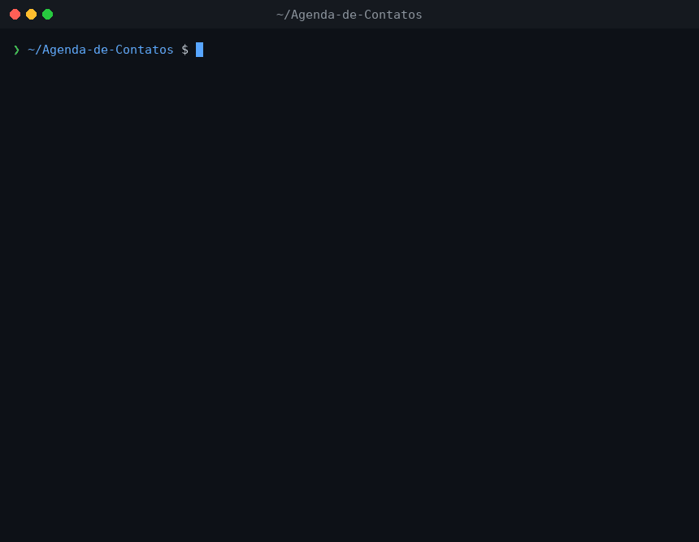

# 📒 Agenda de Contatos

<p>
  <a href="https://github.com/futuremltz/Agenda-de-Contatos/actions/workflows/build.yml"></a>
  <a href="LICENSE"></a>
</p>
 
Projeto desenvolvido como desafio prático do módulo **Introdução ao Python** da [Rocketseat](https://rocketseat.com.br/), com o objetivo de reforçar os conceitos fundamentais da linguagem por meio de uma aplicação real e funcional.
 
---
 
## 💡 Sobre o projeto
 
Uma agenda de contatos que roda no terminal e permite ao usuário gerenciar seus contatos de forma simples e intuitiva. O sistema oferece um menu interativo com todas as operações essenciais de um CRUD.
 
---
 
## 🎬 Demonstração

<p align="center">
  
</p>

---

## ✨ Funcionalidades
 
- ✅ **Adicionar contato** — salva nome, telefone e e-mail
- 📋 **Ver contatos** — lista todos os contatos cadastrados com status de favorito
- ✏️ **Editar contato** — atualiza os dados de um contato existente
- ⭐ **Favoritar/Desfavoritar** — marca ou desmarca um contato como favorito (toggle)
- 🌟 **Ver favoritos** — exibe somente os contatos marcados como favoritos
- 🗑️ **Apagar contato** — remove um contato da lista
---
 
## 🚀 Como executar
 
### Pré-requisitos
 
- [Python 3](https://www.python.org/downloads/) instalado na sua máquina
### Rodando o projeto
 
```bash
# Clone o repositório
git clone https://github.com/futuremltz/Agenda-de-Contatos.git
 
# Acesse a pasta
cd Agenda-de-Contatos
 
# Execute o arquivo
python agenda_de_contatos.py
```
 
---
 
## 🖥️ Exemplo de uso
 
```
Agenda de Contatos
1.Adicionar contato
2.Ver contatos
3.Editar contato
4.Favoritar contato
5.Ver contatos favoritos
6.Apagar contato
7.Desligar
 
Digite a sua escolha: 1
Digite o nome do contato: Maria
Digite o telefone: 11999999999
Digite o email: maria@email.com
Contato salvo com sucesso
```
 
---
 
## 🧠 Conceitos praticados
 
- Funções e modularização de código
- Listas e dicionários
- Laços de repetição (`while`, `for`)
- Estruturas condicionais (`if/elif/else`)
- Entrada e saída de dados (`input` / `print`)
- Manipulação de índices e validações
---
 
## 📚 Tecnologias
 
| Tecnologia | Versão |
|---|---|
| Python | 3.14.3|
 
---
 
## 👨‍💻 Autor
 
Feito com 💜 durante a jornada na **Rocketseat**.
